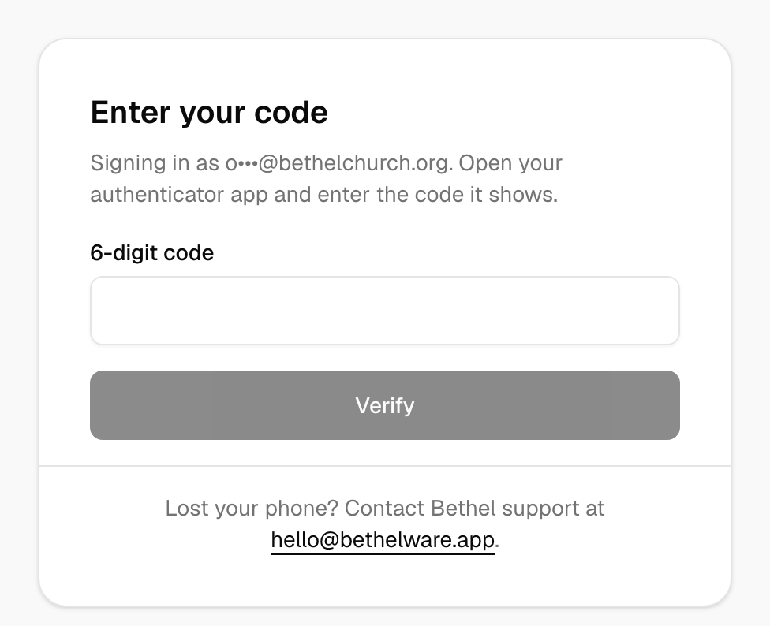

Everyone on your team signs in to Bethel ChMS at [app.bethelchms.com](https://app.bethelchms.com) with their email address, their password and a 6-digit code from an authenticator app on their phone. This page covers signing in, what to do if you forget your password, and how to sign out.

<Info>
**Who can do this:** Anyone with a Bethel ChMS account. If you don't have one yet, ask your church administrator to [invite you](/getting-started/invite-users), or [set up your church](/getting-started/setup) if you're the first person to use Bethel ChMS.
</Info>

## Sign in

<Steps>
  <Step title="Open the sign-in page">
    Go to [app.bethelchms.com](https://app.bethelchms.com). The **Welcome back** page opens. If you're already signed in, Bethel ChMS skips this page and takes you straight to your starting page.
  </Step>
  <Step title="Enter your details">
    Enter your **Email** and **Password**.
  </Step>
  <Step title="Let the security check finish">
    A small security check appears above the button. It usually completes by itself. See [The security check](#the-security-check) below.
  </Step>
  <Step title="Sign in">
    Click **Sign in**.
  </Step>
  <Step title="Enter the code from your phone">
    The **Enter your code** page opens. Open your authenticator app, type the 6-digit code it shows into **6-digit code** and click **Verify**.

    The first time you sign in, the **Set up two-step verification** page opens instead, so you can connect your authenticator app. See [Two-step verification and devices](/guides/account-security#set-up-two-step-verification).

    <Frame>
      
    </Frame>
  </Step>
</Steps>

### Two-step verification

Bethel ChMS protects your church's data with **two-step verification**: after your password, you enter a 6-digit code from an authenticator app on your phone, such as Google Authenticator or Microsoft Authenticator. Everyone who uses Bethel ChMS needs it, whatever their role. Each computer or phone asks for a code again every 30 days.

Porter workers don't need a code for everyday Porter work. Porter admins need one for **Setup** and the other admin screens.

For setting it up, signing in on more than one device, and what to do if you lose your phone, see [Two-step verification and devices](/guides/account-security).

### Show or hide your password

Every password field in Bethel ChMS has an eye icon at its right-hand edge. Click or tap it to show what you've typed, so you can check for mistakes. Click it again to hide your password.

You'll find the eye icon wherever you type a password: signing in, signing up, resetting your password, accepting an invitation, signing in to Porter, and confirming an ownership transfer.

### The security check

To keep your church's data safe from automated attacks, the pages where you sign in, sign up, or ask for a password reset link include a small security check from Cloudflare. It confirms that a real person is using the page.

- Most of the time it finishes on its own.
- Now and then it asks you to tick a box.
- The button below it stays greyed out until the check has passed.
- If you try to sign in and it doesn't work, the check runs again before your next try.

The same check appears when you sign in to Porter and when you transfer ownership of your organisation.

<Tip>
If the security check never finishes, refresh the page. If that doesn't help, try another browser or turn off any browser extension that blocks content on websites.
</Tip>

## Where you land after signing in

Bethel ChMS takes you to the page that fits your role.

| Your role | Where you land |
| --- | --- |
| **Org Owner**, **Org Admin**, **Branch Admin**, **Editor** | **Dashboard** |
| **Treasurer** | **Gifting & Donations** |
| **Care Manager** | **Care** |
| Someone who only has Porter access | **Porter** |
| Someone who has signed up but hasn't created their church in Bethel ChMS yet | The setup wizard |

**Porter** is the Bethel ChMS phone app for service teams, such as workers and volunteers. To learn more, see [Porter](/guides/porter). For a tour of the menus once you're signed in, see [Find your way around](/getting-started/find-your-way-around).

## If you can't sign in

If your email or password is wrong, the page shows:

> Email or password is incorrect. Check both and try again, or reset your password.

Check that you're using the email address your invitation was sent to, and use the eye icon to check your password. If you still can't get in, [reset your password](#reset-a-forgotten-password).

You may also see one of these messages under a field:

| Message | What to do |
| --- | --- |
| **Email is required** | Enter your email address. |
| **Enter a valid email address** | Check the email address for typos, such as a missing `@`. |
| **Password is required** | Enter your password. |
| **Password must be at least 8 characters** | Bethel ChMS passwords are always at least 8 characters, so check what you typed. |

If your 6-digit code isn't accepted, you'll see **That code didn't work. Check the time on your phone and try again.** Codes depend on your phone's clock, so make sure its date and time are set automatically. If you've lost your phone, ask your church's Org Owner or an Org Admin to reset your two-step verification. See [Lost your phone?](/guides/account-security#lost-your-phone)

If you open an old or broken link from a Bethel ChMS email, you land back on the sign-in page with a message such as **Invalid confirmation link**, or one that says the link has expired and what to do next. Sign in with your email and password. An old invitation link opens the **Invitation Error** page instead. See [Problems with an invitation link](#problems-with-an-invitation-link).

## Reset a forgotten password

<Steps>
  <Step title="Ask for a reset link">
    On the sign-in page, click **Forgot password?**. The **Reset your password** page opens.
  </Step>
  <Step title="Enter your email">
    Enter your **Email**, let the security check finish, and click **Send reset link**.

    You'll always see **If an account exists for that email, we've sent a password reset link. Check your inbox.** Bethel ChMS shows the same message whether or not the email has an account, so nobody can use this page to find out who uses Bethel ChMS. If you entered the wrong address, click **Use a different email**.
  </Step>
  <Step title="Open the email">
    Open the password reset email from Bethel ChMS and click **Reset My Password**. If you can't find it, check your spam or junk folder.
  </Step>
  <Step title="Choose a new password">
    The link opens **Reset your password** with the message **Choose a new password.** Enter a **New password** of at least 12 characters, with upper-case and lower-case letters and at least one number, type it again in **Confirm password**, and click **Reset password**.

    When your new password is saved, you're signed in. For your security, Bethel ChMS signs you out on any other devices, so you'll need to sign in there with your new password.

    Resetting your password doesn't change your two-step verification.
  </Step>
</Steps>

<Warning>
If you've already set up two-step verification, the reset form can't save your new password. Instead it shows **AAL2 session is required to update email or password when MFA is enabled.** Ask your church's Org Owner or an Org Admin to [reset your two-step verification](/guides/account-security#reset-someones-two-step-verification), then ask for a new reset link and choose your password. Bethel ChMS then asks you to set up two-step verification again. If you're the Org Owner, contact Bethel ChMS support as described in [Lost your phone?](/guides/account-security#lost-your-phone)
</Warning>

If the two passwords don't match, you'll see **Passwords do not match**. If you leave the second box empty, you'll see **Please confirm your password**.

<Note>
Reset links expire, and each one works only once. If you open an old or used link, you'll see **Reset link expired**. Click **Request a new link** to get a fresh email, or **Back to sign in** if you've remembered your password.
</Note>

## Problems with an invitation link

If an invitation link has expired or has already been used, Bethel ChMS can't verify it. You'll see an **Invitation Error** page with the reason, for example:

> This invitation has expired. Please contact your administrator for a new invite.

What to do next depends on whether you've already set a password:

- **You already set your password.** Sign in with the email address the invitation was sent to. On the **Invitation Error** page, click **Back to sign in** first. If you've forgotten the password, click **Forgot password?**.
- **You haven't set a password yet.** Ask your church administrator to resend your invitation from the **Users** page. See [Invite your team](/getting-started/invite-users). If they can't find your invitation there, you've already opened it once, so click **Forgot password?** on the sign-in page and choose a password that way.

## Sign out

Sign out when you've finished, especially on a shared or church office computer.

- **On a computer, or a tablet held landscape:** At the bottom of the sidebar, next to your email address, click the **Sign out** icon.
- **On a tablet held portrait, or a phone:** Open **More** and tap **Sign out**.

Bethel ChMS signs you out and opens the sign-in page, so you or the next person can sign in again.

**Sign out** signs you out on every device where you're signed in with your account, not just the one you're using. Any other browser or app, including Porter, asks you to sign in again at its next step. To see where you're signed in, or to sign out just one other device, open **Sign-in and security**. See [See and sign out your devices](/guides/account-security#see-and-sign-out-your-devices).

## Related pages

- [Two-step verification and devices](/guides/account-security)
- [Find your way around](/getting-started/find-your-way-around)
- [Install the app](/getting-started/install-the-app)
- [Invite your team](/getting-started/invite-users)
- [Porter](/guides/porter)
