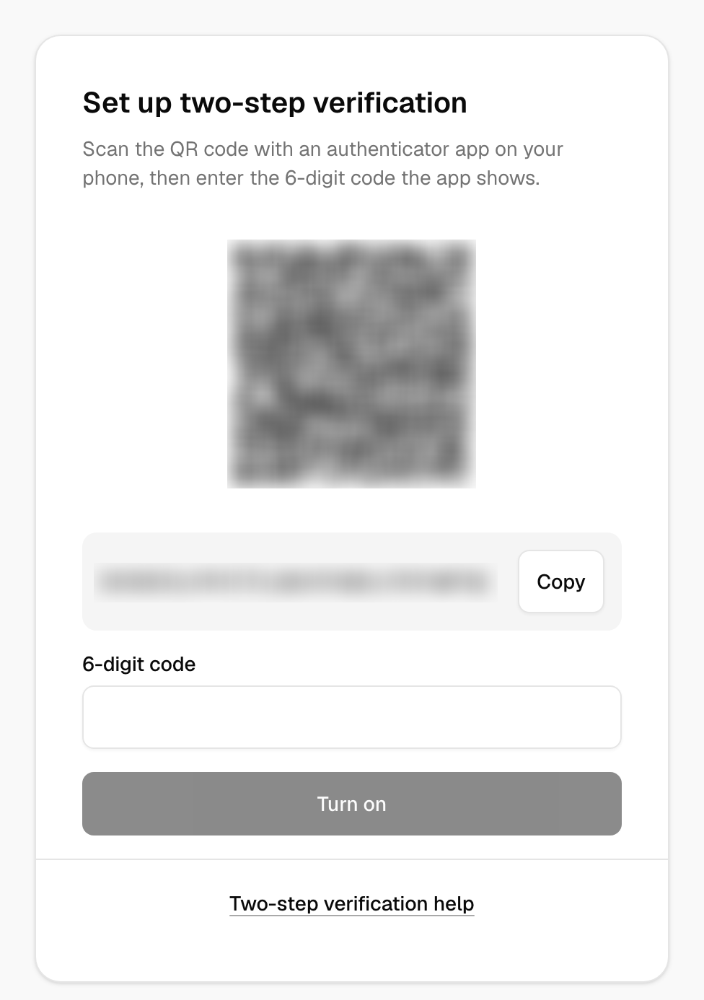
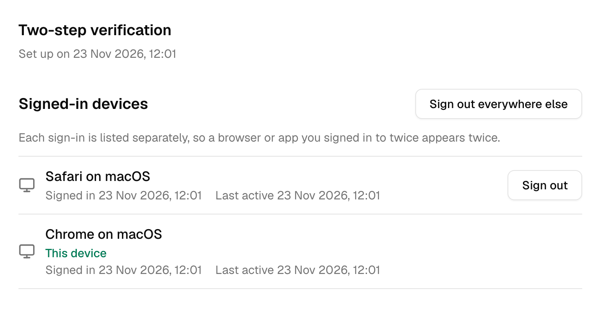
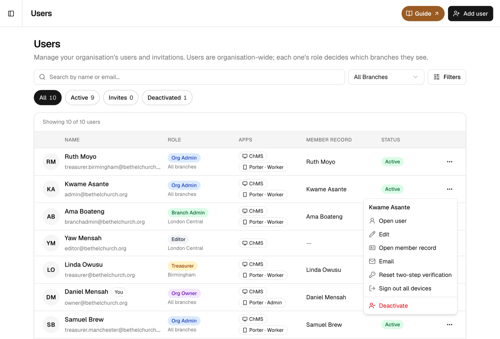

**Two-step verification** adds a second check when you sign in. After your password, you enter a **6-digit code** from an **authenticator app** on your phone. Someone who learns your password still can't get in without your phone, which keeps your church's member, giving and care records safe.

This page also covers **Sign-in and security**, where you can see every browser and app signed in to your account and sign out any you don't recognise, and what Org Owners and Org Admins can do when someone loses their phone or leaves.

<Info>
**Who can do this:** Everyone who uses Bethel ChMS sets up and uses two-step verification for their own account, whatever their role. Anyone with a sign-in can see and sign out their own devices. Only **Org Owners** and **Org Admins** can reset someone else's two-step verification or sign someone else out of all devices.
</Info>

## Who needs two-step verification

| Who | When they're asked for a code |
| --- | --- |
| Everyone who uses Bethel ChMS (**Org Owner**, **Org Admin**, **Branch Admin**, **Editor**, **Treasurer**, **Care Manager**) | Every time they sign in to Bethel ChMS, and again on each device every 30 days. |
| Someone setting up a new church | Right after confirming their email address, before the first setup step. |
| **Porter** admins | When they open **Setup** or another Porter admin screen. |
| **Porter** workers | Never. Checking in, tasks, the rota and equipment loans only need a password. |

There's nothing to switch on and no deadline. Bethel ChMS asks you to set it up the first time you need it, and takes you back to where you were going afterwards.

## What you need

An authenticator app on your phone, such as Google Authenticator, Microsoft Authenticator, 1Password or Authy. Any app that shows 6-digit codes that change every 30 seconds works.

Each person needs their own authenticator. If several people share a church office computer, each one signs in as themselves and uses the app on their own phone.

## Set up two-step verification

You do this once.

<Steps>
  <Step title="Sign in">
    Sign in to Bethel ChMS with your email and password, or open an admin screen in Porter. The **Set up two-step verification** page opens.
  </Step>
  <Step title="Scan the QR code">
    Open your authenticator app, add a new account and scan the QR code on the page.

    If you can't scan it, for example because you're setting up on the same phone, click **Can't scan? Enter this key instead**. Click **Copy** next to the key and paste it into your authenticator app.

    <Frame>
      
    </Frame>
  </Step>
  <Step title="Enter the code">
    Type the 6-digit code your authenticator app shows into **6-digit code** and click **Turn on**.
  </Step>
</Steps>

Bethel ChMS takes you straight on to the page you were opening, and your Change history records **Two-step verification set up**.

If the code isn't accepted, you'll see **That code didn't work. Check the time on your phone and try again.** The QR code and key stay on screen, so you don't need to scan again. Codes depend on your phone's clock, so make sure its date and time are set automatically.

## Sign in with a code

After you enter your password, the **Enter your code** page opens. It shows the email address you're signing in with, partly hidden, so you can check it's the right account.

<Steps>
  <Step title="Open your authenticator app">
    Find the entry you added when you set up two-step verification.
  </Step>
  <Step title="Enter the code">
    Type the 6-digit code into **6-digit code** and click **Verify**.
  </Step>
</Steps>

Good to know:

- **Each device asks every 30 days.** Once you've entered a code on a computer or phone, that device doesn't ask again for 30 days, as long as you stay signed in. Each new sign-in asks for a code.
- **Already signed in to Porter?** If you're signed in to Porter as a worker and then open Bethel ChMS or a Porter admin screen, you aren't asked for your password again, only for the code.
- **Too many wrong codes** in a row and you're asked to wait a little before trying again.

<Tip>
The bottom of the **Enter your code** page tells you what to do if you've lost your phone. See [Lost your phone?](#lost-your-phone)
</Tip>

## Using more than one device

Bethel ChMS and Porter keep their own sign-ins. Using Bethel ChMS on a laptop doesn't sign you out of Porter on your phone, and moving between the two apps on one device doesn't change anything on your other devices.

The **Sign out** button is different. Clicking **Sign out** in Bethel ChMS or Porter signs you out on every device where you're signed in with that account, not just the one you're using.

There's one more thing to know. When you enter a correct code on one device, Bethel ChMS signs you out on any other device that signed in with a password alone. Devices that have already had a code entered stay signed in. For example, if you use Bethel ChMS on your laptop and Porter as a worker on your phone, entering a code on the laptop may sign you out of Porter on the phone. Sign in on the phone again with your password to carry on.

## See and sign out your devices

**Sign-in and security** shows whether two-step verification is set up for your account, and every browser and app signed in to it.

<Info>
**Who can do this:** Anyone with a Bethel ChMS or Porter sign-in, for their own account. Porter workers can use it with their password alone.
</Info>

<Steps>
  <Step title="Open Sign-in and security">
    - **In Bethel ChMS on a computer, or a tablet held landscape:** click **Sign-in and security** at the bottom of the sidebar, just above your email address.
    - **In Bethel ChMS on a tablet held portrait, or a phone:** open **More** and tap **Sign-in and security** under your email address.
    - **In Porter:** tap your initials to open the account menu and choose **Sign-in and security**. On a tablet on its side or a computer, it's also at the foot of the rail down the left, above **Sign out**.
  </Step>
  <Step title="Check your devices">
    Under **Two-step verification**, you'll see **Set up on** followed by the date, or **Not set up**.

    Under **Signed-in devices**, each row shows the browser and system, such as "Chrome on macOS" or "Safari on iPhone", with when it **Signed in** and when it was **Last active**. The one you're using says **This device**. No IP address or location is shown.

    <Frame>
      
    </Frame>
  </Step>
  <Step title="Sign out a device you don't recognise">
    Click **Sign out** on that row, then **Sign out** again to confirm. Whoever is using it is taken to the sign-in page at their next step, and needs your password to get back in.

    To sign out every device except the one you're using, click **Sign out everywhere else** and confirm.
  </Step>
</Steps>

Your Change history records **Signed out a device** or **Signed out every other device**.

<Note>
The list shows **sign-ins**, not physical devices. Each browser or app you sign in to is its own row, so the same laptop can appear twice (two browsers, or a private window), and two phones using the same browser look alike. If you don't recognise a row, sign it out. If you're not sure, use **Sign out everywhere else** and sign in again where you need to. If you think someone knows your password, [change it](/getting-started/sign-in#reset-a-forgotten-password) too.
</Note>

## Lost your phone?

If you've lost the phone with your authenticator app, or replaced it without moving the app across, ask your church's **Org Owner** or an **Org Admin** to reset your two-step verification. They can't see your codes. A reset simply removes your old authenticator.

After the reset:

1. You're signed out on every device, and you get an email saying who reset it.
2. Sign in again with your email and password.
3. The **Set up two-step verification** page opens. [Set it up](#set-up-two-step-verification) with the authenticator app on your new phone.

If you get the reset email but didn't ask for a reset, contact the person named in the email.

**If you're the Org Owner,** nobody in your church can reset you. The **Enter your code** page shows the Bethel ChMS support email address. Email it, and support will reply to the email address on your account and ask you a question about your organisation before resetting. Support will never ask for your password or a code.

## Reset someone's two-step verification

Use this when someone in your church has lost their phone.

<Info>
**Who can do this:** **Org Owner** and **Org Admin**, for anyone in the organisation except themselves and the Org Owner. This includes Porter-only admins. Branch Admins and other roles can't reset two-step verification.
</Info>

<Steps>
  <Step title="Find the person">
    In the sidebar, open **Organisation** and click **Users**. On a tablet or computer, click **⋯** on the person's row. You can also open their user page and click **⋮**.
  </Step>
  <Step title="Choose Reset two-step verification">
    Choose **Reset two-step verification**. It only appears for people who have set up two-step verification.

    <Frame>
      
    </Frame>
  </Step>
  <Step title="Confirm with your own code">
    The sheet explains that they'll be signed out everywhere and asked to set up two-step verification at their next sign-in. Enter the 6-digit code from **your own** authenticator app and click **Reset**.
  </Step>
</Steps>

Bethel ChMS confirms with "Two-step verification reset". The person gets an email, and their Change history shows **Two-step verification reset** with your name.

Because resetting someone's security is a sensitive action, Bethel ChMS checks that the code was entered within the last minute. If you see **Enter a new code from your authenticator app to confirm.**, wait for your authenticator app to show a new code, enter it in the same sheet and try again.

If you haven't set up two-step verification yourself yet, the sheet asks you to do that first. Click **Set up two-step verification**, and you'll come back to **Users** afterwards.

## Sign someone out of all devices

Use this when someone left a church phone or computer signed in, or has lost a device. Their access doesn't change, and you never see their list of devices.

<Info>
**Who can do this:** **Org Owner** and **Org Admin**, for anyone in the organisation except themselves and the Org Owner. To sign yourself out of other devices, use [Sign-in and security](#see-and-sign-out-your-devices).
</Info>

<Steps>
  <Step title="Open the person's menu">
    On the **Users** page, click **⋯** on the person's row, or **⋮** on their user page, and choose **Sign out all devices**.
  </Step>
  <Step title="Confirm with your own code">
    Enter the 6-digit code from **your own** authenticator app and click **Sign out**.
  </Step>
</Steps>

Bethel ChMS confirms with "Signed out of all devices". Every browser and app they're signed in to is signed out at its next step. They can sign in again with their password. Their Change history shows **Signed out of all devices** with your name.

**Sign out all devices** appears for active and deactivated users, but not for someone whose invitation is still pending. As with a reset, the code must be one you've just entered.

## What happens when you remove someone's access

Removing someone's access also signs them out of every device straight away, with no code needed:

- [Deactivating](/guides/user-management#deactivate-or-reactivate-a-user) a Bethel ChMS user.
- Removing Porter, by unticking **Porter** in **Edit user** or choosing **Remove Porter** from the person's **⋯** menu.

Removing one app doesn't remove the other, because one sign-in opens both apps:

| You remove | They still have | What happens |
| --- | --- | --- |
| Bethel ChMS (deactivated) | Porter | Signed out everywhere. They can sign in to Porter again, but not Bethel ChMS. |
| Porter | Bethel ChMS | Signed out everywhere. They can sign in to Bethel ChMS again. |
| Bethel ChMS or Porter | Nothing | Signed out everywhere, and they can't sign in at all. |

To remove both apps, do them in either order. Giving access back, by choosing **Reactivate** or giving them Porter again, lets them sign in again.

If you untick your own Porter access, your other devices are signed out and the one you're using stays signed in.

## Delete your account

At the bottom of **Sign-in and security**, anyone can delete their own sign-in. Click **Delete my account** to open a page that explains what's deleted and what your church keeps. Click **Delete my account**, then confirm with **Delete my account**.

Your sign-in, two-step verification and signed-in devices are deleted, and you're signed out everywhere. Your church keeps your member record and the history of your work, such as check-ins and equipment loans.

<Warning>
Deleting your account can't be undone. An **Org Owner** can't delete their account until they [transfer ownership](/guides/roles-and-permissions#transferring-ownership) of the organisation. If you only want to stop someone using Bethel ChMS, [deactivate them](/guides/user-management#deactivate-or-reactivate-a-user) instead.
</Warning>

## What Change history records

These entries appear on the person's user page, or on the member record for someone with Porter only. See [Change history](/guides/change-history).

| Entry | When |
| --- | --- |
| **Two-step verification set up** | The person set up two-step verification. |
| **Two-step verification reset** | An Org Owner or Org Admin reset it. Shows who did it, or "Bethel support" when Bethel ChMS support reset an Org Owner. |
| **Signed out a device** | The person signed out one of their own devices. |
| **Signed out every other device** | The person used **Sign out everywhere else**. |
| **Signed out of all devices** | An Org Owner or Org Admin used **Sign out all devices**. Shows who did it. |

## Related pages

- [Sign in and reset your password](/getting-started/sign-in)
- [User management](/guides/user-management)
- [Roles and permissions](/guides/roles-and-permissions)
- [Porter](/guides/porter)
