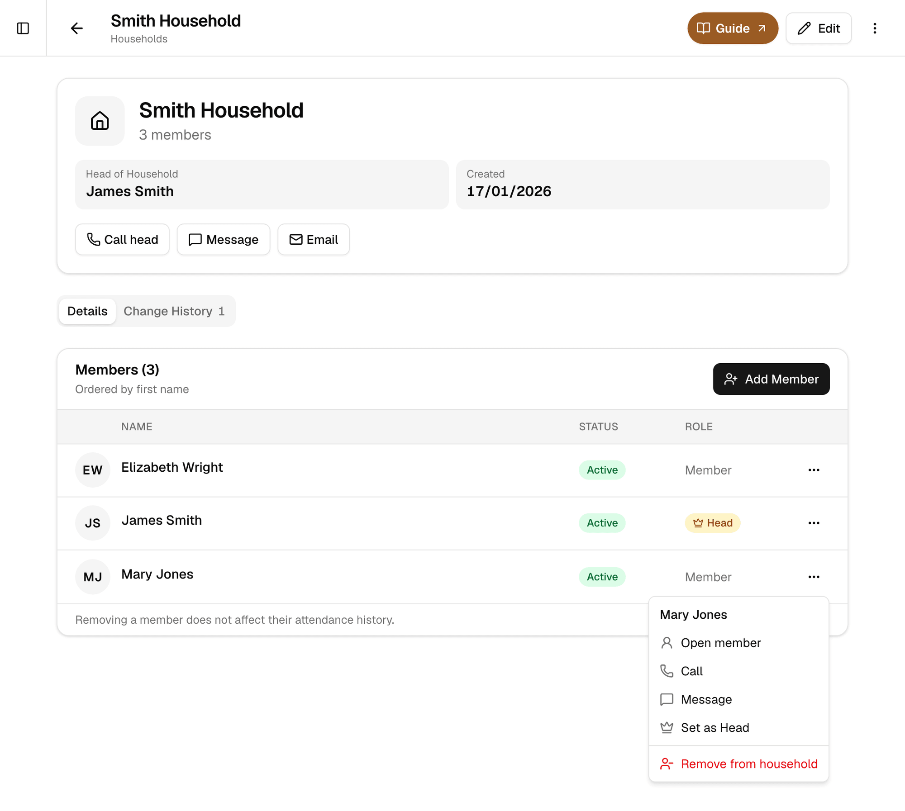

A **household** groups members who live together or belong to the same family, such as "The Smith Family". Use households to see related members side by side, keep track of who heads each home, and reach the head of household quickly by phone, text or email.

Each household belongs to one branch, and a member can be in only one household at a time.

<Info>
**Who can do this:** Org Owner, Org Admin, Branch Admin and Editor can create and edit households, add members, set the head of household and remove members. Only Org Owner, Org Admin and Branch Admin can delete a household. Treasurers and Care Managers do not have access to Households.
</Info>

## Open Households

In the sidebar, open **People** and click **Households**. On a tablet held upright, **Households** is one of the shortcuts in the rail on the left. On a phone, tap **More** in the tab bar, then **Households**.

If you are an Org Owner or Org Admin, choose the branch you want to work in with the branch selector first. Households are shown one branch at a time. See [Find your way around](/getting-started/find-your-way-around) for where the branch selector sits on each device.

## Find a household

The **Households** page lists every household in the branch, 25 at a time, sorted by name.

- Type in **Search by household name…** to find a household by name.
- Use the quick chips under the search box to show **All** households, only households with a head (**Has head**), or only households without one (**No head**). Each chip shows how many households match.
- Open **Filters** to sort by **Name**, **Members** or **Created**, in either direction, and to filter by **Head of household** or by the number of **Members** (**1**, **2–3**, **4 or more** or **Empty**).

On a computer or tablet, the list shows **Household Name**, **Head of Household**, **Members** and **Created**. On a phone, each row shows the household name, the head's name and the member count, and households without a head show **No head assigned** in amber.

Click a household to open its page. Each row also has a **⋯** menu with **Open household**, **Edit** and, for roles that can delete, **Delete**.

<Tip>
Use the **No head** chip from time to time to find households that still need a head of household assigned.
</Tip>

## Create a household

<Steps>
  <Step title="Open the Add Household sheet">
    On the **Households** page, click **Add Household** in the top bar. On a phone, tap the **+** button.
  </Step>
  <Step title="Enter a name">
    Enter a **Household Name**, for example "The Smith Family". Names can be up to 100 characters and must be unique within the branch.
  </Step>
  <Step title="Create the household">
    Click **Create Household**. Bethel ChMS confirms with **Household created**.
  </Step>
</Steps>

A new household starts empty. Open it to [add members](#add-members).

## The household page

The household page brings everything about one household together.

- **Summary card:** shows the number of members, the **Head of Household** and the date the household was **Created**. When the head of household has a mobile number on their record, the card also shows **Call head** and **Message** buttons. When they have an email address, it shows an **Email** button. Use these to contact them in one tap.
- **Details** tab: the **Members** list, ordered by first name. Each member shows their **Status** (**Active**, **Newcomer** or **Inactive**), any tags, and their **Role** in the household: a **Head** badge or **Member**.
- **Change History** tab: a record of changes made to the household. See [Change history](/guides/change-history).

If the household has members but nobody is set as head, the page shows a reminder suggesting you assign one.

The top bar has an **Edit** button (a pencil on phones) and a **More actions** menu (⋮) with **Add Member**, **Edit household** and, for roles that can delete, **Delete household**.

<Frame>
  
</Frame>

## Add members

You can add one person or several people at once, up to 20 at a time.

<Steps>
  <Step title="Open the household">
    On the **Households** page, click the household.
  </Step>
  <Step title="Start adding members">
    Click **Add Member** in the **Members** section, or open the **More actions** menu (⋮) and choose **Add Member**.
  </Step>
  <Step title="Find and pick people">
    Type in **Type a name…** and click a person in the results to pick them. A tick shows they are picked, and their name appears as a chip under the search box. Type another name to pick the next person. To take someone off the list, click their chip.

    Each result shows the household the person is already in, or **No household**. Only members of the same branch appear, and people already in this household are left out.
  </Step>
  <Step title="Add them">
    Click **Add Member**. When you have picked more than one person, the button shows how many, for example **Add 3 Members**. If anyone you picked is already in another household, the button reads **Move and Add** instead.
  </Step>
</Steps>

If you added one person, Bethel ChMS confirms it with a message. If you added several people, or moved someone from another household, the sheet shows what happened for each person, such as **Added**, **Added as head of household** or **Moved from** their old household. Click **Done** to close it.

<Note>
A member can only belong to one household. If you pick someone who is already in another household, Bethel ChMS shows a warning naming that household before you add them. Adding them moves them: they are removed from their old household, and if they were head of that household, the old household has no head until you set a new one.
</Note>

When you add people to an empty household, the first person you picked becomes the head of household automatically. The sheet tells you who this will be before you add them. You can change this at any time with **Set as Head**.

## Work with a member in a household

Click a member in the **Members** list, or their **⋯** button, to see their options:

- **Open member** opens their member record.
- **Call** and **Message** appear when the member has a mobile number.
- **Set as Head** makes them the head of household. It does not appear for the person who is already the head.
- **Remove from household** takes them out of this household.

### Set the head of household

A household has one head. The head's name appears in the household list and on the summary card, and they carry the **Head** badge in the members list.

1. Click the member, then choose **Set as Head**.
2. In **Set Head of Household**, click **Set as Head** to confirm.

If the household already had a head, that person becomes an ordinary member of the household.

### Remove a member

1. Click the member, then choose **Remove from household**.
2. In **Remove Member**, click **Remove** to confirm.

Removing someone from a household only clears their household link. Their member record stays, and their attendance history is not affected.

## Manage a household from a member's record

**Who can do this:** Org Owner, Org Admin, Branch Admin, Editor

You can also manage households from the member's own page. Open the member and go to their **Household** tab.

- If they are not in a household yet, click **Assign to Household**, search for the household, then click **Assign**.
- If they are in a household, the tab shows the household name, a **Head** badge if they head it, and the other members. Click **Remove from Household** to take them out.

See [Managing members](/guides/managing-members) for more about member records.

## Edit or delete a household

To rename a household, open it and click **Edit**, or choose **Edit** from the household's **⋯** menu on the **Households** page. Change the **Household Name** and click **Save Changes**.

To delete a household, open its **⋯** menu on the **Households** page and choose **Delete**, or open the household and choose **Delete household** from the **More actions** menu (⋮). Click **Delete** to confirm.

<Warning>
Deleting a household removes every member from it and clears their head of household status. The member records themselves are kept. This cannot be undone.
</Warning>
