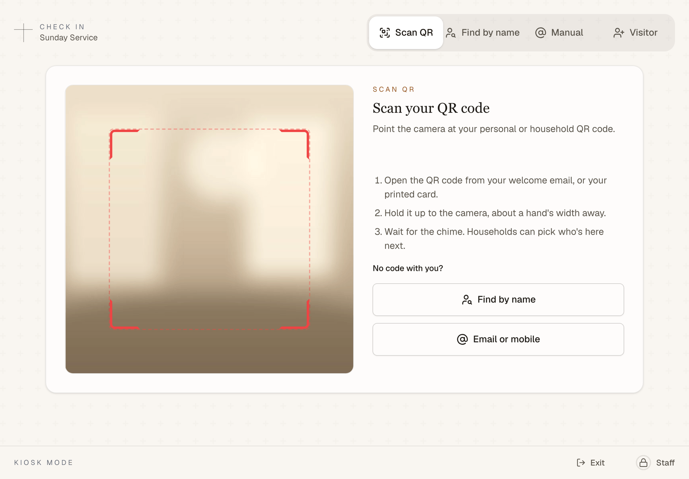

**Kiosk mode** turns a tablet or laptop at your entrance into a self check-in station for one event. Members and visitors check themselves in by scanning their QR code, typing their email or mobile number, finding their name, or registering as a first-time visitor. Their check-ins go straight onto the attendance list for that service.

An **occurrence** is one date and time of an event, for example this Sunday's 10:00 service. When you open kiosk mode, it picks today's occurrence of the event and checks everyone in to it. It keeps checking which occurrence is current, so a kiosk left open stays on the right one. See [A kiosk left open stays on the right service](#a-kiosk-left-open-stays-on-the-right-service).

<Info>
**Who can do this:** Org Owner, Org Admin, Branch Admin and Editor can open kiosk mode. People using the kiosk don't need to sign in.
</Info>

## Before you start

- **Public Check-in** must be on for the event. See [Set up public check-in](/guides/recording-attendance#set-up-public-check-in).
- The kiosk works all day on the day of the event, before and after the service. On a day with no occurrence it says there's no check-in today. See [How long check-in stays open](/guides/recording-attendance#how-long-check-in-stays-open).
- To scan QR codes, the device needs a camera. A tablet on a stand at the door works well.

<Tip>
Plug the tablet in before the service. Kiosk mode keeps the screen on while it runs, which uses more battery.
</Tip>

## Open kiosk mode

<Steps>
  <Step title="Open the event">
    In the sidebar, open **Church life** and click **Events**, then select the event. On a phone, tap **Events** in the tab bar.
  </Step>
  <Step title="Open the Settings tab">
    Click the **Settings** tab and find the **Public Check-in QR** card.
  </Step>
  <Step title="Launch the kiosk">
    Click **Launch Kiosk Mode**. The kiosk opens in a new browser tab.
  </Step>
</Steps>

You can also open kiosk mode from these places:

- Click **QR & kiosk** on the service's card on the **Dashboard**, at any time until the day ends, or on its **Live now** card on the **Events** page while it is in progress. The kiosk opens in a new tab. If public check-in is off for that event, you go to the event page instead.
- In the events list, open the event's **⋯** menu and choose **QR & kiosk**. This option appears only for events with public check-in on.

## What people see at the kiosk

The top of the screen shows "Check in" and the event name. Beside it on a wide screen, or below it on a narrower one, a row of tabs lets people choose how to check in:

- **Scan QR**
- **Find by name**, if your church has [Find by name (Quick Find)](/guides/quick-find) switched on
- **Manual**, for email or mobile number
- **Visitor**, for first-time visitors

The kiosk always opens on **Manual**, so people can type their email or mobile number straight away. The tabs show only on these starting screens, not while someone is part-way through checking in.

### Scan QR

<Frame>
  
</Frame>

The **Scan QR** screen asks people to point the camera at their QR code. On a wide screen, such as a tablet held landscape or a laptop, it also shows three short steps: open the QR code from the welcome email or a printed card, hold it about a hand's width from the camera, and wait for the chime.

Under **No code with you?**, people can tap **Find by name** (when it's switched on) or **Email or mobile** instead.

The kiosk uses the front camera, the one facing the person. If the device has more than one camera, a button lets you switch cameras, and the device remembers your choice.

What happens after a scan depends on the code:

| Code scanned | What the kiosk does |
| --- | --- |
| A member's personal code | Checks them in straight away and shows "Checked in" with their name and **Done**. If they're already in, it shows "Already checked in". |
| A personal code, for a member in a household | Asks who else from the household is here. Everyone is ticked to begin with. They tap **Check in** to check in themselves and everyone ticked (the button shows the number), **Just me** for only themselves, or **Back**. |
| A visitor's code from their welcome email | Shows "Welcome back" with their name and a **Check In** button. |
| A code Bethel ChMS doesn't recognise | Shows **Member not found**, with **Check in as Visitor**, **Manual Check-in** and **Close**. |

Anyone in a household who is already checked in can't be ticked again. If everyone is already in, the kiosk says so.

If a scan fails, for example because of a brief connection problem, the person can hold up the same code again after about two seconds. They don't need to tap anything first.

#### If the camera doesn't work

- If the browser hasn't been allowed to use the camera, the kiosk shows "Camera permission needed to scan QR codes". Allow camera access in the browser settings, then tap **Try again**.
- If a steward has turned the camera off in [Staff options](#staff-options), the kiosk asks people to use Find by name or their email or mobile number instead.

### Find by name

Members type their first name and the start of their surname, pick themselves from a short list and confirm. Children never appear in the list. See [Find by name (Quick Find)](/guides/quick-find).

### Manual

The **Manual** tab asks people to type the email or mobile number your church has for them, then tap **Continue**. From there it works the same way as [self check-in on a phone](/guides/recording-attendance#self-check-in-on-a-phone): people confirm their name, choose who else from their household is here, or register as a visitor if they aren't found.

The field is cleared after each person, and the kiosk never suggests an email address someone else typed earlier.

### Visitor

The **Visitor** tab opens the **Register** form. Visitors enter their name, an email address or mobile number, and any other details your church asks for, then tap **Register & Check In**.

Visitors who give an email address are emailed their personal check-in QR code straight away, so they can scan it at the kiosk next time.

### When someone has checked in

The confirmation screen shows "Checked in" with the person's first name. For a household, it shows how many people were checked in and lists their names. Below that is "Welcome. We're glad you're here." and a **Done** button.

The screen stays up until the person taps **Done**, or until the kiosk resets itself.

## The kiosk resets itself

After 30 seconds with nobody touching the screen, typing or moving the mouse, the kiosk goes back to **Manual** and clears the last person's details. This happens on every kiosk screen, including the confirmation screen and Find by name, so the next person never sees someone else's name.

This only happens in kiosk mode, never on a member's own phone.

## The check-in chime

The kiosk plays a short beep every time someone checks in successfully, whichever way they checked in. It stays silent when someone is already checked in or isn't found.

Browsers only play sound after someone has touched the screen, so tap the kiosk once after you open it. You can turn the chime off in [Staff options](#staff-options).

The chime plays only in kiosk mode. It doesn't play on members' phones or when staff use **Scan QR** on the attendance page.

## Staff options

The bottom of the kiosk shows "Kiosk Mode" with two buttons, **Exit** and **Staff**. Both need a press and hold of about a second, so people tapping around the screen can't reach them by accident. A short tap shows "Hold to exit" or "Hold for staff".

To change the kiosk's settings:

1. Press and hold **Staff** until the lock opens.
2. In **Staff options**, use the switches:
   - **Camera** turns the camera for **Scan QR** on or off.
   - **Keep screen on** stops the tablet dimming or locking during the service.
   - **Chime on check-in** turns the [check-in chime](#the-check-in-chime) on or off.
3. Close the dialog.

All three switches start on. They aren't saved, so if the kiosk page reloads they go back to on.

## Move the kiosk to the next service

Two services on one day are two events, and each has its own kiosk. So that nobody is checked in to the wrong service, the kiosk tells staff when a later service at your branch is on today. The prompts are for staff, and members don't need to do anything.

The prompts appear only when the kiosk's device is signed in to Bethel ChMS as an Org Owner, Org Admin, Branch Admin or Editor. Otherwise the staff bar at the bottom shows "Sign in here as staff who can take attendance to get service switch prompts." and the kiosk carries on working without them.

**While this service is running**, a banner appears below the top bar on the starting screens. It reads, for example, "Next: Second Service at 11:00. Staff: press and hold to switch." Press and hold **Switch** to move the kiosk now. Check-ins carry on as normal, so you can also ignore it.

**Once this service has ended**, staff must choose before the kiosk takes any new check-ins. The check-in tabs disappear, and the Scan QR, Find by name and Manual screens are replaced by a card asking **Which service is this kiosk for?** It says which service ended and when the next one starts, for example "Morning Service ended at 10:30. Second Service starts at 11:00.", and tells members "If you're here to check in, please ask a member of the welcome team." Anyone part-way through checking in can finish. Press and hold one of the two buttons:

- **Switch to** the next service opens that service's kiosk. It's a full page load, so the switches in [Staff options](#staff-options) go back to on.
- **Stay on** this service keeps the kiosk where it is, for example so that latecomers can finish.

A short tap shows a reminder to press and hold, so that a member can't move the kiosk by accident.

If you choose **Stay on** before the next service starts, the kiosk asks again when it starts. If you choose it after the next service has started, the kiosk stays for the rest of the day, unless there's another service after that. Reloading the kiosk forgets your choice, so it asks again.

The kiosk only prompts for services that apply to everyone at the branch. A group's meeting doesn't prompt a Sunday kiosk, and neither does a service with **Public Check-in** off. If one event has two occurrences on the same day, there's nothing to choose: the kiosk moves to the current one by itself.

## A kiosk left open stays on the right service

A kiosk checks which occurrence it should be on after each person taps **Done**, when it resets itself, when its screen wakes or its tab comes back into view, and every five minutes while its tab is showing. If the occurrence has changed, for example because a kiosk was left open overnight and a new day's occurrence has begun, the kiosk moves to it by itself. It never interrupts someone who is part-way through checking in.

The same checks keep the kiosk up to date in other ways:

- On the "no check-in today" screen, the kiosk opens check-in by itself once the day of the event arrives.
- If someone turns **Public Check-in** off, the kiosk shows "Check-in is not available for this event." by itself, and opens again when it is turned back on.
- If [Find by name](/guides/quick-find) is switched on or off for your branch, the kiosk adds or removes the **Find by name** tab.

If a check-in is refused because the service has closed, the person sees "Check-in for this service has closed. Please speak to the welcome team." and the kiosk checks again straight away, so the next person is checked in to the right occurrence.

<Tip>
The five-minute check only runs while the kiosk's tab is showing. If a tablet has been asleep, wake the screen and the kiosk catches up within a few seconds.
</Tip>

## Exit kiosk mode

1. Press and hold **Exit**.
2. In **Exit kiosk mode?**, click **Exit kiosk mode**. To carry on, click **Stay in kiosk**.

The device goes to the attendance page for this occurrence in Bethel ChMS, where staff can carry on taking attendance. Members can't check themselves in on this device again until you launch kiosk mode again. The attendance page is part of Bethel ChMS, so you need to be signed in to see it.

**Exit** is on every kiosk screen, including the error and "no check-in today" screens. If the kiosk has no occurrence open, **Exit** goes to the event's page instead, or to **Events** if the check-in link no longer works.

## Kiosk check-ins in attendance

Check-ins from the kiosk are added to the occurrence's attendance list straight away. If a steward already has the attendance page open, kiosk check-ins appear there shortly after the steward's next check-in, or when they reload the page. Their capture method is **Kiosk**, **Kiosk QR** or **Self Check-in**. See [How each check-in is labelled](/guides/recording-attendance#how-each-check-in-is-labelled).

## Troubleshooting

<Accordion title="The kiosk says there's no check-in today">
"There's no check-in for this event today" means the event has no occurrence on today's date. Check the date of the next occurrence, and check that today's occurrence hasn't been cancelled. See [How long check-in stays open](/guides/recording-attendance#how-long-check-in-stays-open).

The kiosk checks again by itself every five minutes while its tab is showing, so it opens when the day of the event arrives. To check straight away, tap **Try again**.
</Accordion>

<Accordion title="The kiosk doesn't ask about the next service">
The kiosk asks only when the device is signed in as staff who can take attendance, and only when both the kiosk's event and the later service apply to everyone at the branch and have **Public Check-in** on. The later service must be today, at the same branch, and not yet ended. See [Move the kiosk to the next service](#move-the-kiosk-to-the-next-service).
</Accordion>

<Accordion title="The kiosk says check-in is not available">
"Check-in is not available for this event." means **Public Check-in** is off. Edit the event, turn on **Public Check-in** and launch kiosk mode again.
</Accordion>

<Accordion title="The kiosk says Event not found">
The check-in link has changed, usually because someone clicked **Regenerate Token**. Close the kiosk's browser tab and launch kiosk mode again from the event's **Settings** tab.
</Accordion>

<Accordion title="There is no Find by name tab">
Find by name appears only when it has been switched on for your church and branch. See [Turn on Find by name](/guides/quick-find#turn-on-find-by-name). Then reload or relaunch the kiosk.
</Accordion>

<Accordion title="The kiosk doesn't play a sound">
Tap the screen once after opening the kiosk, check the device volume, and check that **Chime on check-in** is on in [Staff options](#staff-options).
</Accordion>
