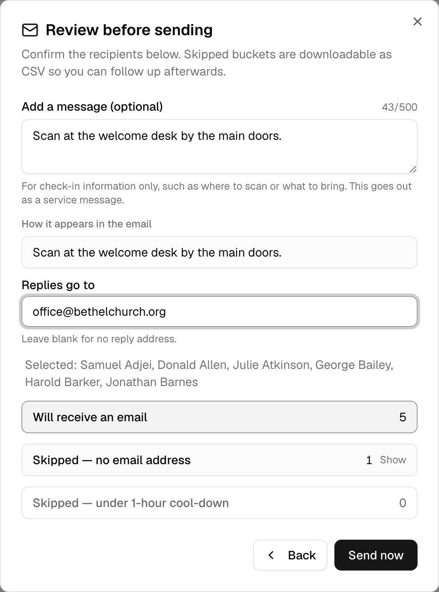
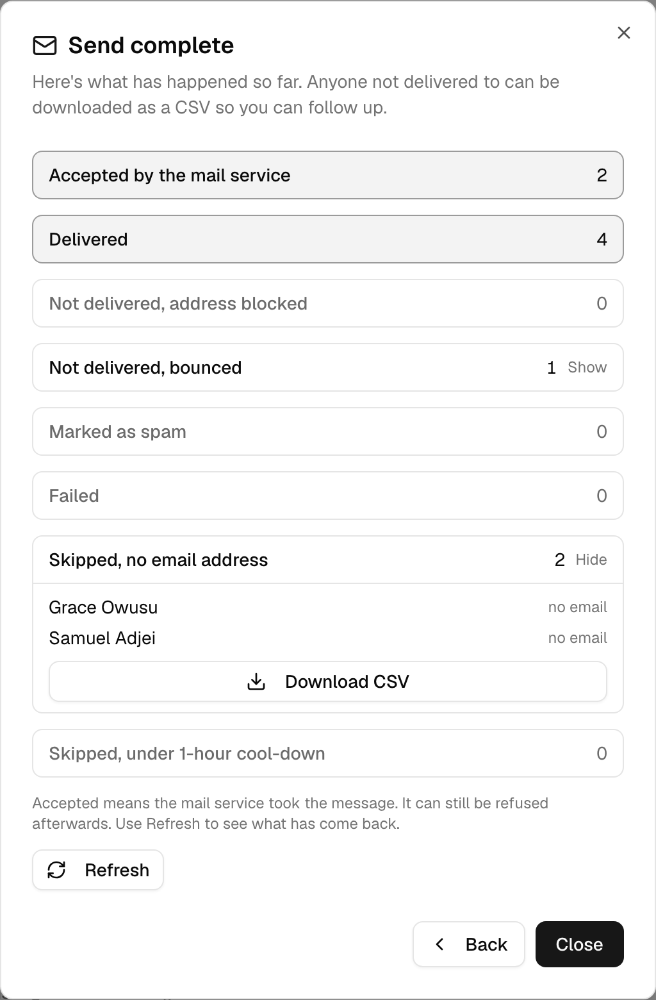

import { Video } from "/snippets/videos.jsx";

Every member has a personal **check-in QR code**. They show it at a kiosk or at the door, and it checks them in to the service in seconds. The same code works on every visit. See [Recording attendance](/guides/recording-attendance) and [Kiosk mode](/guides/kiosk-mode).

You can show a member their code on screen, or email it to them. The email links to the member's own **View my code** page, where they can keep the code handy or add it to their phone's wallet.

<Video id="checkin" chapter="qr" />

<Info>
**Who can do this:** Org Owner and Org Admin can email QR codes, one member at a time or many at once. Anyone who can open a member's page can show that member's code on screen. Members open their own code from their email, and don't need a Bethel ChMS sign-in to do it.
</Info>

## Show one member's code

On the member page, click **QR Code** in the top bar, tap the **QR code** quick action, or open the **More actions** menu (⋮) and choose **Show QR code**. The dialog shows the member's name and code, with "Scan this code to record attendance".

Click **Full screen** to show the code edge to edge, so it is easy to scan from your screen. Click **Done** to go back.

## Email one member their code

**Who can do this:** Org Owner, Org Admin

In the member's QR code dialog, click **Email code**. When the mail service has taken the email, you see "Handed to the mail service for" and the member's name.

- If the member has no email address, the button is greyed out and the dialog says "Add an email address to email the code."
- A member can only be emailed their code once an hour. If you try again sooner, you see "This member's code went to the mail service in the last hour."

Bethel ChMS also emails a new member their code when you add them with an email address. See [Add a member](/guides/managing-members#add-a-member).

## What the member receives

The email's subject is "Your check-in code for" followed by your church's name. If your church has more than one branch, the member's branch is added after the church name. The email is signed off with your church's name too, so members can tell straight away who it's from.

The email contains:

- The member's QR code, ready to show at the entrance.
- Your message, if you added one when sending to many members.
- A **View my code** link that opens the member's own code page.
- **Add to Apple Wallet** and **Add to Google Wallet** buttons, for the wallets that are available. The email suggests opening it on a phone to add the code to a wallet.

If you gave a reply-to address, the member's replies go there. Otherwise the email has no reply address.

## Email codes to many members

**Who can do this:** Org Owner, Org Admin

Use this to send codes to a whole branch, a filtered group, or members you've picked from the list, for example before you start using kiosks.

<Steps>
  <Step title="Open Email QR codes">
    In the sidebar, open **People** and click **Members**. Open the **⋯** menu next to **Filters** and choose **Email QR codes**. To email only some members, tick them in the list first and click **Email QR codes** in the selection bar.
  </Step>
  <Step title="Choose who should receive a code">
    Choose one of the three options:

    - **Selected members**: the members you ticked in the list.
    - **All members of this branch**: every active or newcomer member of the branch.
    - **Filter**: narrow the branch by **Status**, **Age groups** and **Groups**. With no status ticked, active and newcomer members are included.

    For **All members of this branch** and **Filter**, choose the **Branch** to send to. The list is hidden if your church has only one branch. The dialog then shows how many members will be considered. Click **Continue**.
  </Step>
  <Step title="Add a message and a reply-to address">
    On **Review before sending**, you can type a short message in **Add a message (optional)**, up to 500 characters. Keep it to check-in information, such as where to scan or what to bring. Under **How it appears in the email**, you see your message laid out as members will read it.

    In **Replies go to**, enter the email address that should receive replies, for example your church office. Leave it blank for no reply address.

    <Frame>
      
    </Frame>
  </Step>
  <Step title="Check who will receive an email">
    **Will receive an email** shows how many emails will be sent. Below it, Bethel ChMS lists who will be skipped because they have no email address, or because they were sent a code in the last hour. Click a list to see the names and click **Download CSV** to follow up later. To include the people sent a code in the last hour, tick **Send again anyway**.
  </Step>
  <Step title="Send the emails">
    Click **Send now**. While **Sending QR codes** is open, you see how far the send has got, for example "Sending 40 of 120…". Keep the window open until it finishes. To stop part way, click **Stop this send**.
  </Step>
</Steps>

When the send finishes, the delivery report opens. See [Check what happened to a send](#check-what-happened-to-a-send).

<Note>
If branch-wide emails aren't switched on for your church yet, **All members of this branch** and **Filter** are greyed out and read "Branch-wide emails are not switched on yet". You can still use **Selected members** for up to 25 people at a time, and **Email code** on a member's page.
</Note>

### Pick up an interrupted send

If you close the dialog, lose your connection or close your browser while a send is under way, the send pauses. Nobody is sent a code twice, because Bethel ChMS records each email as it goes.

The next time you open **Email QR codes**, you see "An earlier send has not finished" with how many have been done. Click **Resume** to carry on from where it stopped, or **Stop this send** to end it. A new send to several people has to wait until the earlier one is resumed or stopped.

If a send pauses while the window is still open, for example because of a connection problem, a **Resume** button appears under the progress bar.

## Check what happened to a send

The delivery report shows what happened to each email, so you know who to follow up.

| Line | What it means |
| --- | --- |
| **Accepted by the mail service** | The email was handed over for delivery. It can still be refused afterwards. |
| **Delivered** | The member's email provider accepted the email. |
| **Not delivered, address blocked** | The mail service won't send to this address, for example because earlier emails to it bounced or were marked as spam. |
| **Not delivered, bounced** | The member's email provider refused the email. The address may be wrong or no longer used. |
| **Marked as spam** | The member marked the email as spam. |
| **Failed** | The email couldn't be sent. The reason is shown beside the name. |
| **Skipped, no email address** | The member has no email address. |
| **Skipped, under 1-hour cool-down** | The member was sent a code in the last hour. |

For a stopped send, the report also shows **Not sent, send stopped** and **Outcome unknown, may have been sent**.

Click any line except **Accepted by the mail service** and **Delivered** to see the names, and click **Download CSV** to save the list. Delivery news can take a few minutes to come back, so click **Refresh** to bring the report up to date.

<Frame>
  
</Frame>

### Past sends

At the bottom of the **Email QR codes** dialog, open **Past sends** to see your church's 20 most recent sends. Each one shows when it was sent, who sent it, who it went to (**Selected members**, **All members of a branch** or **Filtered members**, with the branch), the message, and a tally such as "Accepted 110 · Delivered 4 · Skipped 6". A send marked **Not finished** or **Stopped** says so.

Click a send to open its delivery report. Click **Back** to return to the list. If a send is **Not finished**, you can **Resume** it or **Stop this send** from its report.

## The member's View my code page

When a member clicks **View my code** in their email, their code opens on its own page in their phone's browser. The page shows your church's name, their QR code and their first name with the first letter of their surname. They can show this page at check-in instead of searching for the email.

The page says "Bookmark this page or add it to your Home Screen." The link doesn't change, so a bookmark keeps working, and every QR code email the member receives links to the same page.

The link stops working if the member's record is deleted.

## Add the code to a phone wallet

A member can keep their code in Apple Wallet or Google Wallet, so it is always on their phone without hunting for the email. They tap **Add to Apple Wallet** or **Add to Google Wallet** in their email or on their **View my code** page. The wallet card scans at the kiosk and at the door just like the code in the email.

<Tabs>
  <Tab title="Apple Wallet">
    On an iPhone, tapping **Add to Apple Wallet** shows the card, and the member taps **Add**. It also works on an iPad or Mac.

    - If the link opens inside another app, such as Outlook or the Google app, the member may see "To add this to Apple Wallet, open this link in Safari." Opening the link in Safari adds the card.
    - On an Android phone or a Windows computer, the member sees "Open this on your iPhone, iPad or Mac to add it to Apple Wallet."
  </Tab>
  <Tab title="Google Wallet">
    Tapping **Add to Google Wallet** first opens a short page explaining what the card shares with Google: the member's first name, the first letter of their surname, your church's name and their check-in code. Adding the card is optional. The member taps **Add to Google Wallet** to save it to their Google account.

    If a member's record is deleted, their Google Wallet card is replaced with an expired one that holds no name or code.
  </Tab>
</Tabs>

If a wallet button isn't in the email or on the page, that wallet isn't available yet. The QR code in the email and on the **View my code** page works just the same.

### Your church's logo and colour on wallet cards

Org Owners and Org Admins can upload your church's logo on the **Organisation Settings** page, so wallet cards show your logo, with white text on your church's colour. Without a logo, cards show the Bethel ChMS logo. See [Wallet pass logo](/guides/organisation-settings#wallet-pass-logo).

A card keeps the look it had when the member added it. If you upload, change or remove your logo, or change the colour, members who already have a card get the new look by adding it again from their email or **View my code** page. The new card replaces the old one.

## Related guides

- [Managing members](/guides/managing-members)
- [Recording attendance](/guides/recording-attendance)
- [Kiosk mode](/guides/kiosk-mode)
- [Organisation settings](/guides/organisation-settings)
